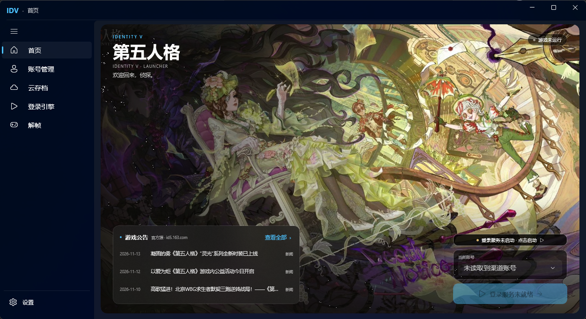
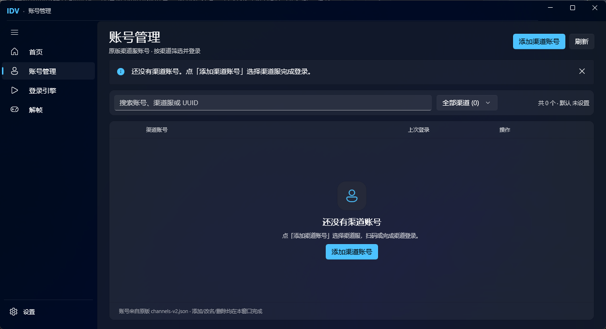
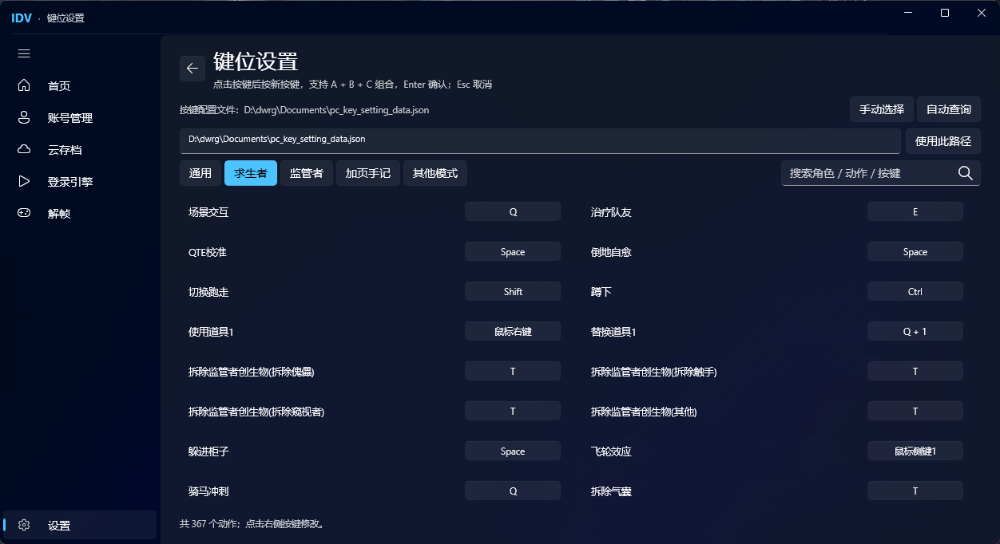

# WinUI3 IDV Launcher

面向《第五人格》PC 端的 WinUI 3 单窗口启动器。

[](https://github.com/daoqishul/WinUI3-IDV-Launcher/actions/workflows/build.yml)
[](LICENSE)
[](https://dotnet.microsoft.com/)

> 非官方工具，与网易 / 第五人格官方无关。使用前请阅读免责声明。
怎么登录操作：
>方法A：打开后点开“登录引擎“打开”自动扫码登录“随后前往”账号管理点击“添加渠道账号“进行登录，登录好后右边有个星星的标志点亮，启动游戏点开扫码界面可以自动扫了
> 方法B：直接开启游戏应该会有内置的登录窗口出现扫码一次后面都可以手动点击登录了


## 功能

- 渠道账号管理、搜索、收藏
- 原版 IDV-Login 引擎自动启动
- 收藏账号自动登录；可最小化内置登录窗口
- 原版云存档
- 游戏画质、显示模式、帧率、视野范围设置
- WinUI 3 原生键位编辑器
- 解帧工具集成
- 官方公告、托盘、主题、窗口状态记忆

## 界面

| 首页 | 账号管理 |
| --- | --- |
|  |  |

| 键位设置 | 云存档 |
| --- | --- |
|  |  |

## 系统要求

- Windows 10 1809+ 或 Windows 11，x64
- [.NET 8 Desktop Runtime](https://dotnet.microsoft.com/download/dotnet/8.0)
- [Windows App Runtime 1.8](https://learn.microsoft.com/windows/apps/windows-app-sdk/downloads)
- 管理员权限
- 原版 IDV-Login（完整登录 / 云存档功能需要；安装包可内置）
- 《第五人格》PC 客户端（启动游戏需要）

## 下载

前往 [Releases](https://github.com/daoqishul/WinUI3-IDV-Launcher/releases) 下载：

- `IDVLauncher-Setup-*.exe`：安装包
- `IDVLauncher-WinUI3-*-win64.zip`：便携版

## 详细使用

完整功能、数据路径和排错说明见 [docs/USAGE.md](docs/USAGE.md)。

## 从源码构建

使用 Visual Studio 打开：

```text
WinUI3-IDV-Launcher.sln
```

或使用 .NET 8 SDK 命令行：

```powershell
dotnet build .\WinUI3-IDV-Launcher.sln -c Release -p:Platform=x64
```

或生成便携包：

```powershell
.\build.ps1 -Package
```

输出：

```text
dist\
IDVLauncher-WinUI3-v1.0.4-win64.zip
```

## 项目结构

```text
WinUI3-IDV-Launcher.sln Visual Studio 解决方案
winui/                  WinUI 3 主程序
  Pages/                首页、账号、云存档、引擎、键位、解帧、设置
  Services/             引擎、API、云同步、游戏设置、键位、托盘
  Models/               数据模型
  Dialogs/              原生对话框
  Assets/               封面、图标、赞助码、画质预览
  Tools/解帧.exe        解帧工具
data/                   本地公告回退数据
packaging/              发布包说明、安装许可、简体中文语言文件
tools/                  开发辅助脚本
shots/winui/            界面截图
installer.iss           Inno Setup 安装脚本
build.ps1               构建脚本
```

## 数据目录

| 内容 | 路径 |
| --- | --- |
| 启动器设置 / 账号 | `%LOCALAPPDATA%\IDVLauncher` |
| 引擎配置 / 日志 | `C:\ProgramData\idv-login` |
| 原版引擎程序 | 安装包内置时位于 `{app}\engine\IDV-Login` |
| 游戏键位配置 | `<游戏目录>\Documents\pc_key_setting_data.json` |
| 游戏画质配置 | `<游戏目录>\Documents\setting_data.json` |

## 构建安装包

1. 将原版 IDV-Login 程序放到 `engine-payload\IDV-Login`（不提交到仓库）。
2. 安装 [Inno Setup 7](https://jrsoftware.org/isinfo.php)。
3. 执行：

```powershell
& "C:\Program Files\Inno Setup 7\ISCC.exe" .\installer.iss
```

输出：`installer\IDVLauncher-Setup-v1.0.4.exe`

## 参与贡献

请阅读 [CONTRIBUTING.md](CONTRIBUTING.md)。

## 免责声明

本软件为非官方第三方工具，仅用于个人账号管理与游戏启动辅助。使用本软件可能违反游戏用户协议，存在账号封禁、数据丢失等风险；因使用本软件产生的全部后果由使用者自行承担。

本项目不包含《第五人格》游戏本体，也不包含原版 IDV-Login 引擎的源代码。Release 安装包可能内置原版引擎二进制；其许可证见 [NOTICE.md](NOTICE.md)。

## License

[GNU General Public License v3.0](LICENSE)
